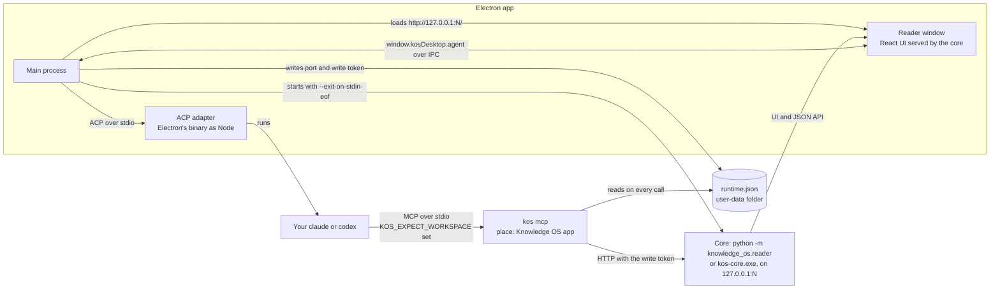
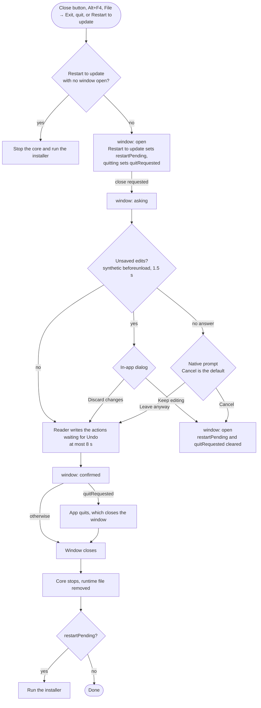

# Desktop app architecture

How the Knowledge OS desktop app works inside. Running, building, releasing,
and testing it is in [`desktop/README.md`](../desktop/README.md); paths below
are relative to `desktop/` unless they start at the repository root.

## Processes

The app is an Electron window around the existing Knowledge OS reader. The main
process runs the Python core (`python -m knowledge_os.reader`, the same server
as `kos-read`) on a free local port and loads the React UI that the core
serves. There is no second UI: the only pages of its own are a small start page
for opening or creating a knowledge base and for showing errors, the
[Clone Knowledge Base](#clone-a-knowledge-base) window, and the
[Referat plugin](#referat-plugin)'s import window. Git, indexing, and every
write run in the core; the main process starts and stops it, keeps the
runtime file for agents, runs the in-app agent's adapter, and draws the window.

The processes and how they reach each other; every write, the in-app agent's
included, ends at the core's local API:



### Which Python runs the core

The installed app runs its bundled `kos-core.exe` and never looks for Python.
Setting `KOS_PYTHON` makes an installed app use that interpreter instead,
which is useful for debugging; the interpreter then needs Knowledge OS
installed, since an installed app has no checkout to put on `PYTHONPATH`.

When the shell runs from a checkout (`npm run dev` or `npm start`), it tries
these in order and uses the first one that is Python 3.11+ and
can import the reader and its dependencies:

1. `KOS_PYTHON`, when set. It is then the only candidate, so a wrong value is
   reported instead of silently replaced.
2. The repository's `.venv` (`.venv\Scripts\python.exe` on Windows).
3. `py -3.11` on Windows (`python3.11`, then `python3`, elsewhere).
4. `python` on PATH.

When the shell runs from a checkout, the checkout is put first on
`PYTHONPATH`, so the core always runs this repository's code. The core's
working directory is the system temp folder, never the workspace or the
checkout.

### How the core is started and stopped

Opening a knowledge base starts
`python -m knowledge_os.reader --root PATH --host 127.0.0.1 --port N --exit-on-stdin-eof`
on a port the operating system reports as free, then polls `/api/workspace`
until it answers and loads `http://127.0.0.1:N/` in the window. Switching to
another knowledge base stops the running core first.

The core is stopped when the window closes, when the app quits, on SIGINT,
SIGTERM, and an uncaught exception in the main process. Each stop kills the
whole process tree (`taskkill /T /F` on Windows), because a venv's `python.exe`
and the `py` launcher each run the real interpreter as a child process. If the
main process dies without running any handler, the core still exits: its stdin
is a pipe held by the main process, and `--exit-on-stdin-eof` makes it exit
when that pipe closes.

## Agents and the runtime file

Agents reach the open knowledge base through `kos mcp`, the MCP server in the
core (see "Agent access over MCP" in
[`docs/architecture.md`](architecture.md)). It finds the running core
through `runtime.json` in the user-data folder
(`%APPDATA%\knowledge-os-desktop\runtime.json` for the installed app, or
under `KOS_DESKTOP_USER_DATA`):

```json
{
  "version": 1,
  "app_version": "0.2.0",
  "port": 51234,
  "url": "http://127.0.0.1:51234",
  "write_token": "...",
  "workspace": { "root": "D:\\notes\\my-kb", "name": "my-kb" },
  "core_pid": 1234,
  "shell_pid": 999,
  "written_at": "2026-09-23T20:00:00.000Z"
}
```

Once the core answers, the shell reads the write token from `GET /api/session`
and writes the file (`src/main/runtimeFile.ts`). Opening another knowledge
base rewrites it; closing the knowledge base, closing the window, quitting, and
a core that stops unexpectedly remove it. It is removed only while it still
names this app's core. A crash can leave a file behind; `kos mcp` uses a file only when `core_pid` is alive and
the port hands out the same write token, and otherwise tells the agent the app
is not answering.

Only one app runs per user-data folder: starting it again focuses the open
window. The in-app agent's `kos mcp` also gets `KOS_EXPECT_WORKSPACE`, the
knowledge base its conversation started in, and refuses every tool call with
`wrong_knowledge_base` (writing nothing) once the runtime file names another
one. `kos mcp` started outside the app has no such variable and uses whichever
knowledge base is open.

The file holds the write token, so only the current user may read it. On
Windows it is written to a temporary file first, whose access list is then set
with `icacls FILE /inheritance:r /grant:r *<your SID>:F` (the SID comes from
`whoami /user`): inherited entries are removed, so Administrators and SYSTEM
lose their inherited access and the current user is the only entry. Only then
is it renamed to `runtime.json`. If that fails, no file is written and agents
report that the app is not open. On macOS and Linux the file is created with
mode `0600`. Run `icacls "%APPDATA%\knowledge-os-desktop\runtime.json"` to see
its access list.

## In-app agents (ACP)

The agent inside the app talks to a coding agent over the
[Agent Client Protocol](https://agentclientprotocol.com) (ACP): JSON-RPC over
the agent process's stdin and stdout, through `@agentclientprotocol/sdk` in the
main process (`src/main/agents/`). The accepted decision is
`projects/knowledge-os/decisions/in-app-agent-provider-isolation.md`.

**Providers.** Each agent is a provider implementing `AgentProvider`
(`src/main/agents/contract.ts`); nothing outside its module knows which agent
it is. A provider says:

- who it is (`id`, `displayName`, and `mcpClientName`, the name its writes
  appear under: "Written by Claude Code in Knowledge OS app");
- its adapter (`adapter`: a lock of the exact version tested and every npm
  package it needs, with integrity hashes, installed on demand);
- how to find the agent on this computer (`detect()`, which never throws: a
  missing agent is `not-installed` with a sentence saying how to install it);
- how to start the adapter (`launchSpec()`);
- how to limit a session to the MCP servers it is given (`sessionMeta()`);
- how to explain sign-in (`authHelp()`);
- whether it can continue an earlier session after a restart
  (`capabilities.sessionResume`).

| Provider | Adapter (pinned) | Runs | Limits |
| --- | --- | --- | --- |
| Claude Code | `@agentclientprotocol/claude-agent-acp` 0.81.2 (104 packages) | your `claude` (`CLAUDE_CODE_EXECUTABLE`) | no built-in tools (`tools: []`), none of your MCP servers, hooks, or settings (`strictMcpConfig`, `settingSources: []`), and no permission-skipping mode (`allowDangerouslySkipPermissions: false`) |
| Codex | `@agentclientprotocol/codex-acp` 1.13.1 (19 packages) | your `codex` (`CODEX_PATH`) | starts in `read-only` mode: editing files and network access need your permission, but Codex's read-only sandbox does not limit reads, so it can read any file your account can without asking, and MCP servers in your own `~/.codex/config.toml` also load. The agent panel asks you to turn Codex on before its first session and shows a notice while it is used |

**Adapters are installed on demand**, not shipped: the Claude adapter depends
on Anthropic's proprietary Claude Agent SDK, which you fetch yourself this
way, as `npx` would. Each provider's adapter is a lock in
`src/main/agents/adapters/*.lock.json`, written by
`node scripts/lock-adapter.mjs <package>@<version> <entry>`: every package in
its dependency tree at the exact version tested, with its tarball URL on
`registry.npmjs.org` and its `sha512` integrity hash. Optional dependencies,
which include the agents' own platform binaries of hundreds of MB, are left
out: the adapters run the `claude` or `codex` you installed and signed in to.
On Windows a native `claude.exe` is preferred over an npm `claude.cmd` shim.

`installer.ts` installs a lock into `agents\<adapter>@<version>` in the
app's user-data folder: it accepts only https tarballs from the npm registry,
downloads through Electron's `net.fetch` (so the system proxy applies), checks
every tarball against its hash before writing it, extracts it without running
any install script and refusing any path outside the package, writes
everything to a staging folder, and renames that into place with a marker
last, so a folder that exists is a whole install. A failed or interrupted
install leaves nothing behind; earlier versions are removed after an update.
No Node or npm is needed on the computer: the adapter then runs with
Electron's own binary as Node (`ELECTRON_RUN_AS_NODE=1`). A new adapter
version reaches you with an app release, after it passed the conformance
suite.

**The shared client** (`acpSession.ts`, `AcpAgentSession`) owns everything
else, the same for every provider: starting and stopping the adapter,
`initialize` without any file-system or terminal capability, `session/new`
with `kos mcp --place "Knowledge OS app"` as the only MCP server,
`session/prompt`, `session/cancel`, `session/load` after a restart when the
provider supports it, and turning `session/update` into plain `AgentEvent`s
(message text, tool calls, the end of a turn). Every
`session/request_permission` becomes a `permission` event that waits for the
person's answer, except for the knowledge base's own read tools
(`KOS_READ_TOOLS`: `search`, `read_page`, `list_projects`, `list_folder`,
`list_proposed_decisions`, `list_proposed_changes`, `read_proposed_change`,
`check_documentation`, and `read_commit` on the `knowledge-os` server), which are allowed without asking. Writes, the
agent's own tools, and any other MCP server's tools always ask. When the agent
needs sign-in the session is `auth-required` with the provider's help (for
example "Run `claude /login` in a terminal"), also when a sign-in expires
during the session and the agent fails a prompt with a sign-in error instead
of ACP's `auth_required`; a process that stops is `crashed`, and
`restart()` starts it again. Because the only tools are those of `kos mcp`,
the in-app agent has exactly the limits of any external agent: it cannot
accept, withdraw, supersede, or delete, its writes carry `agent-authored`
provenance, and they follow the knowledge base's review rules.

`AgentService` (`service.ts`) holds at most one session, in the open knowledge
base, and closes it when the knowledge base closes or the app quits. The main
process exposes it to the reader UI only, as `window.kosDesktop.agent`
(`list`, which says whether each adapter is installed, `installAdapter`, with
`install` progress events, `start`, which refuses with `adapter-missing` until
the adapter is installed, `prompt`, `cancel`, `respondPermission`, `restart`,
`close`, `onEvent`, and the conversation calls `conversations`,
`conversation`, `saveConversation`, and `deleteConversation`).

**The agent panel** is part of the reader UI
(`reader-ui/src/components/AgentPanel.tsx`, state in `lib/agentStore.ts`, the
prompts in `lib/agentPrompt.ts`). It opens from the robot button in the
reader's header or View → Agent (Ctrl+J), and is offered only in the desktop
app, where `window.kosDesktop.agent` exists. The first time, it lists the
providers and offers to install the chosen one's adapter. A request is about
the open knowledge base and the page or project in view ("About: Retry
policy"), and goes in one of two modes:

- **Ask** answers from pages the agent searched and read, and writes nothing;
  the answer links the pages, and "Pages used" lists every page it read.
- **Draft** writes a note or proposes a decision with `write_note` and
  `propose_decision`; "Written" links what it wrote, which shows as written or
  proposed by the agent in Knowledge OS app, and a write held back by the
  review rules waits in Decide.

The mode only steers the words of the prompt; what the agent can do is fixed
by `kos mcp`. Reading the knowledge base needs no permission; every write
asks, inside the answer where the agent waits, and once answered the tool's
row says "allowed" or "refused". Sign-in
trouble shows the command to run and *Try again*; a crashed agent offers
*Restart*; *New conversation* ends the session.

**Review** (#99), the third mode next to Ask and Draft, has the agent go
through what waits in Decide (Enter with an empty request goes through
everything): it reads the proposed decisions and the proposed changes the review
rules held back (`list_proposed_changes`, `read_proposed_change`, both read tools
that need no permission), compares them with what is in force, and writes one
section per item ending in a recommendation (accept, withdraw, discard, or
leave for now). Under the answer each item it recommended on gets its
recommendation and the same one-click actions as Decide, with Undo
(`AgentReview.tsx`); the agent itself still cannot accept, withdraw, or discard
anything.

**Conversations** (#100) are kept on this computer after every answer, in
`conversations/<hash of the knowledge base path>/<id>.json` in the app's
user-data folder (`src/main/agents/conversations.ts`): not in the knowledge
base, and not synced. The panel's history button lists them, newest first,
with when and what they were about; one can be opened, renamed, or deleted,
and the newest 200 per knowledge base are kept. A conversation opened from the
list continues in a new agent session, whose first prompt repeats the latest
earlier turns (at most 12,000 characters). *Save as note*, for the whole
conversation or one answer, writes a draft note in the project in view (general
knowledge without one) with the agent's `agent-authored` provenance: each
request as a heading, its answer, and the pages it used as links; the editor
opens on it. Review rules apply as to any write.

File → New Page (Ctrl+N) opens a new page in the current project (the first
project when none is in view). In the app it has *Start with the agent*: one
line, and the agent drafts the title and body from the knowledge base without
writing anything, for the person to edit and save. New Knowledge Base moved
to Ctrl+Shift+N. The reader receives these menu commands over
`reader:command` (`new-page`, `toggle-agent`).

**Adding a provider.** Write its adapter lock with
`scripts/lock-adapter.mjs`, add a module under `src/main/agents/providers/`
that imports it, and list the provider in `providers/index.ts`. It is done
when it passes the conformance suite (`testing/conformance.ts`), which every
provider runs in `npm test` against a scripted mock ACP agent
(`testing/mockAgent.mjs`): launching the installed adapter with Node, a lock of
hashed npm packages without platform binaries, a session with `kos mcp` as the only MCP
server and no file or terminal access, streamed text, tool calls, permission
questions reaching the person, cancel, sign-in reported as a state, and a
crash followed by a restart. Its own detection and session options get a small
test next to it (`providers.test.ts`).

**Trying a real agent.** `src/main/agents/e2e.test.ts` runs a real provider
end to end and is skipped unless asked for. With the agent installed and
signed in, a running core, and its runtime file:

```powershell
$env:KOS_AGENT_E2E = "claude"
$env:KOS_E2E_ROOT = "D:\notes\test-kb"            # has a project "demo"
$env:KOS_E2E_CORE = "..\.venv\Scripts\python.exe"
$env:KOS_RUNTIME_FILE = "$env:APPDATA\knowledge-os-desktop\runtime.json"
npx vitest run src/main/agents/e2e.test.ts
```

It installs the adapter from the npm registry into a temporary folder the way
the app does, asks the agent to write one note through `kos mcp`, and checks
that the note carries the agent's provenance; it needs the network and uses
the agent's model.

## Start page and errors

The start page opens a folder, creates a new knowledge base in an empty folder
with `kos init`, and lists the ten most recently opened knowledge bases. The
list is stored in `recent-workspaces.json` in Electron's user-data folder. The
File menu has the same actions plus Close Knowledge Base. An entry whose
folder has been moved or deleted is marked "Folder not found", and every entry
has a Remove button (×, after the entry in tab order) that takes it off the
list without touching the folder.

On start, the app reopens the most recently opened knowledge base when its
folder still exists and still has its `knowledge-os.toml` marker
(`src/main/reopen.ts`). It opens through the same path as Open Recent, so the
runtime file for agents is written as usual. If the folder is gone, or it is
no longer a knowledge base (no marker, or the core refuses it), the start page
shows one line saying so, for example "The last knowledge base, my-kb, was not
found at D:\notes\my-kb." Other failures, such as a missing Python, show the
error screen as before. File → Reopen the Last Knowledge Base on Start turns
this off; the choice is stored as `reopenLastWorkspace` in `settings.json`
(default on). `KOS_DESKTOP_WORKSPACE` (see
[Development hooks](../desktop/README.md#development-hooks)) takes precedence over reopening.

An error screen explains a missing Python (or, in the installed app, a missing
bundled core), a folder that is not a knowledge
base, a core that stopped while starting or later, and a refused `kos init`,
and shows the core's own output. A knowledge base with lint issues still opens;
the reader shows those issues itself.

## Clone a knowledge base

File → Clone Knowledge Base… (and Clone from a URL… on the start page) opens
a small window of its own (`src/main/cloneWindow.ts`, `src/renderer/clone.html`,
its own preload script) that asks for a Git URL, a folder to save in (by
default `Documents\Knowledge bases`, or any folder chosen with Choose…), and a
folder name, which follows the URL's last segment until it is edited
(`src/shared/clone.ts`). The window checks the URL and name while you type;
all its text is in `src/shared/cloneText.ts`.

Git runs in the Python core, not in Electron: the main process starts
`kos clone URL PATH --json --cancel-on-stdin-eof` (`src/main/cloneRunner.ts`),
so cloning uses the same Git runner as sync (Git from `PATH`, prompts
disabled, the computer's own credential helper or SSH agent, timeouts that
kill the process tree, and passwords redacted from every message; see "Git
versioning and sync" in [`docs/architecture.md`](architecture.md)).
The window shows the core's progress events and a Cancel button. Cancel, or
closing the window, closes the core's stdin: the core stops Git and removes
what the clone wrote; after 20 seconds the main process kills the process
tree itself. A target folder that is not empty is refused, a repository
without `knowledge-os.toml` is reported and left where it was cloned, and a
knowledge base with lint findings is offered with Open anyway. Otherwise its
index is rebuilt and it opens in the main window, which keeps the previous
knowledge base open until then. No credential is asked for or stored; a URL
with a password in it is refused.

Setting up sync for a knowledge base that is not in Git yet, has no remote,
or has never been published is done in the reader, on its Sync page (see
"Guided setup" in [`docs/architecture.md`](architecture.md)).

## Window frame, menu, and dialogs

Every window draws its own frame in the app's design instead of the stock
Windows title bar (`src/main/windowChrome.ts`, `src/chrome/`). The native
title bar is hidden with `titleBarStyle: 'hidden'`, and Windows' own
minimise, maximise, and close buttons stay through the title-bar overlay,
coloured from the design tokens (`--color-bg-sidebar` behind, `--color-text`
for the symbols). Keeping Windows' buttons keeps snap layouts on the maximise
button, the system menu (Alt+Space, or right-click on the bar), double-click
to maximise, and the right behaviour when maximised; fully custom buttons
would have to rebuild all of that. The overlay follows the page's theme: the
start page and the secondary windows follow the system, the reader follows its
own light/dark toggle.

The rest of the title bar (app icon, menu, page title and knowledge base
name, and room for Windows' buttons) is drawn into the page, in a closed
shadow root, so page styles cannot change it. In the main window the preload
script draws it, from its isolated world, into both the start page and the
reader; the reader is served by the core and knows nothing of the app except
that it leaves room at the top through the `--kos-titlebar-height` CSS
variable. The Clone and Referat windows draw the same bar, without a menu,
from their own pages. The bar keeps its size whatever the page's zoom, and
gives up the space for Windows' buttons in full screen, where there are none.

The menu is the same as the old native menu bar, built from one model
(`src/main/menuModel.ts`) that also matches the keyboard shortcuts in the
main process (`before-input-event`), so Ctrl+O and the rest work from any
page. Alt or F10 moves the focus to the menu (with underlined access keys),
Alt+letter opens a menu, arrow keys, Home, End, and first letters move
through it, Enter or Space runs an item, and Escape goes back one level and
then to the page. On macOS the same model is also the native application
menu, which the system expects there. View → Reload and Toggle Developer
Tools, with their shortcuts, exist only in development (`npm run dev` and
`npm start`); the packaged app leaves them out and opens its windows with
`devTools: false`.

Only Help → About and the question for a reader that does not answer use a
native message box (`dialog.showMessageBox`). Update news and the
Referat plugin's messages are quiet notices under the title bar that never
block the window. The unsaved-changes question is an in-app dialog: before
the window closes (the close button, Alt+F4, File → Exit, Restart to update),
reloads, closes the knowledge base, or opens another one, the main process
asks the reader whether its editor would object to leaving (a synthetic
`beforeunload` event) and, if so, shows the dialog; *Keep editing* keeps the
page and cancels a pending restart to update, *Discard changes* lets exactly
that one unload through. A reader that does not answer within 1.5 seconds
gets the native question instead, since its own dialog would not show;
*Cancel* is the default. After that question, and before the core is stopped,
the reader is asked to write the decision actions still waiting for Undo
(`src/main/flushReader.ts`, at most 8 seconds); only then does the window close,
the core stop, and, for Restart to update, the installer start.

Closing, quitting, and restarting to update all run through the same states in
`src/main/closeFlow.ts`:



The native file and folder pickers stay native. All of the shell's
own wording is in `src/shared/shellText.ts`.

The chrome's calls from the main window (menu commands, notice and dialog
answers, the page's theme) are answered only for that window's top frame,
and only while it shows the start page or the open knowledge base's core;
they are not exposed to the page's own scripts, and the chrome only acts on
trusted input events.

## Security

Every window runs with `contextIsolation`, `sandbox`, and no `nodeIntegration`.
Each has its own preload script in `src/preload/`, and the main process checks
which window and page every call comes from.

The main window's preload (`src/preload/index.ts`) exposes
`window.kosDesktop`, the `DesktopApi` in `src/shared/types.ts`:

- For the start page only, refused from any other page (`handle` in
  `src/main/index.ts`): `getState`, `openWorkspace`, `createWorkspace`,
  `cloneWorkspace`, `openRecent`, `removeRecent`, `showStart`, and `retry`.
  `onStateChanged` listens for the state the main process sends.
- For the reader UI of the open knowledge base only (`isReaderPage`):
  `getSidebarWidth` (which answers `null` to any other page),
  `setSidebarWidth` (ignored from any other page), and the in-app agent's
  `agent.list`, `installAdapter`, `start`, `prompt`, `cancel`,
  `respondPermission`, `restart`, `close`, `conversations`, `conversation`,
  `saveConversation`, and `deleteConversation` (refused from any other page).
  `agent.onEvent` and `onReaderCommand` (the New Page and Agent menu commands)
  listen for events the main process sends to the window.

The same preload draws the window chrome (title bar, menu, notices, and
dialogs) and talks to the main process for it from its isolated world; those
calls are not exposed to the page (see
[Window frame, menu, and dialogs](#window-frame-menu-and-dialogs)). The Clone
Knowledge Base window's preload (`src/preload/clone.ts`) exposes
`window.kosClone` (`defaults`, `chooseParent`, `start`, `cancel`,
`onProgress`, `open`, `close`), and the Referat import window's
(`src/preload/referat.ts`) exposes `window.referat` with eight calls (see
[Referat plugin](#referat-plugin)); the main process answers each only for its
own window.

Navigation is limited to the start page and the running core's origin; web
links open in the system browser, and every other scheme is blocked.
Permission requests are denied. The Clone and Referat windows navigate nowhere
beyond their own page.

The core's write endpoints need a per-process token. The shell passes nothing:
the UI, served from the core's own origin, reads the token from
`GET /api/session` and sends it back in the `X-KOS-Write-Token` header. The
shell reads the same token for the runtime file that `kos mcp` uses (see
[Agents and the runtime file](#agents-and-the-runtime-file)). See
"Local interface write API" in [`architecture.md`](architecture.md). The
packaged app's Electron fuses are listed in
[`desktop/README.md`](../desktop/README.md#electron-fuses).

## Referat plugin

[Referat](https://github.com/sockulags/referat) records meetings and writes
their minutes on this computer. The Referat menu, enabled while a knowledge
base is open, has two items:

- **Record Meeting with Referat** starts the installed Referat, or does
  nothing when it is already running (Referat has no single-instance lock).
- **Import Meeting from Referat…** opens the import window.

The import window lists Referat's meetings, newest first. Meetings Referat is
still recording or processing are shown but cannot be imported, and meeting
folders Referat's files could not be read from are listed with the reason.
Choosing a finished meeting shows a preview: which minutes to import when
Referat wrote several (the newest "Protokoll" is the default), the decisions
found in them with a checkbox each, the target project (the one shown in the
main window, else the one Referat was last started from) and folder (default
`meeting-notes`), and a checkbox for the full transcript, which is off by
default. Importing creates:

- One active note titled after the meeting, with the date, duration, and
  meeting reference, then the minutes' sections under Summary, Decisions,
  Action items, and Open questions. Sections with other headings are kept
  under their own heading; the transcript is added only when ticked. Voice
  embeddings are never read. The knowledge base's `meeting-notes` template
  (see "Write pages" in the [main README](../README.md)) sets the order and
  wording of those sections: a section whose name matches one of the
  template's `## ` headings, ignoring case, takes that heading's place, the
  template's headings the meeting has nothing for are left out, and other
  sections follow. Without a usable template the order above is kept.
- One draft decision per ticked item under the decisions heading, linked to
  the note with `related`. When the knowledge base's review rules send
  Referat notes to review (see "Review before writes land" in the
  [main README](../README.md)), the decisions are created first and the note,
  which then waits in Decide, lists them under `related` instead. Decisions are drafts because of the approval
  policy; they govern nothing until someone accepts them.

The minutes are Markdown written by a language model, so sections are found
by heading name at any heading level (or a line that is only bold text):
Sammanfattning/Summary, Beslut/Decisions, Actionpunkter/Action items, and
Öppna frågor/Open questions, plus a few common variants. Each top-level list
item under the decisions heading is one decision, with nested items kept in
its body; without a list, each sub-heading or paragraph is one. A placeholder
such as "Inga beslut fattades." gives no decisions, and minutes without a
decisions heading import no decisions; the preview says which case applies.

Every record carries provenance `referat-meeting` with reference
`referat:<meeting id>` (see "Local interface write API" in
[`docs/architecture.md`](architecture.md)). Ids are the meeting's
local date plus words from the title or decision text, such as
`2026-09-21-planeringsmote-vecka-39`. An id that is taken gets a `-2`, `-3`,
... suffix, both when checked beforehand and when the core answers
`duplicate`; nothing is overwritten. Before previewing and again before
writing, the plugin looks for records that already carry the meeting's
reference; a meeting imported before is offered as "Already imported" with
links to the records instead of being imported twice.

All writes go through `POST /api/records` of the running core, one record at
a time, so each is validated like any interface write and auto-committed
when the knowledge base is a Git repository. The note is written first; if it
fails, nothing else is written. If a decision fails, the result lists exactly
which records were created, which were not and why, and offers to retry the
failed decisions against the same note.

The plugin lives in `src/main/plugins/referat/`, with its page
`src/renderer/referat.html` and preload script `src/preload/referat.ts`. It
uses [referat-sdk](https://github.com/sockulags/referat-sdk), pinned to
`v0.1.0` and bundled into the main process. The SDK only reads Referat's
data folder and runs in the main process; the import window's preload
exposes eight calls (context, list meetings, preview, import, retry, launch,
open a record, close), which the main process answers only for that window.
Nothing passed to the window names a file path. The core and the reader have
no Referat code. When Referat is not installed, the window says so and the
rest of the app is unchanged.
